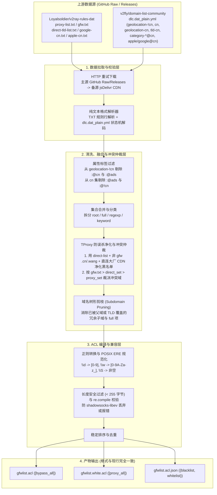

# 基于 v2ray-rules-dat 与 domain-list-community 替代 gfwlist 的分流规则生成架构设计

> **状态**：已确认方案并落地实施（方案一：策略 A + `v2fly/domain-list-community` 直连 + `gfw.txt` 冲突保护 + 拟态原版格式）  
> **目标仓库**：`xl.acl`  
> **核心约束**：完全替代 `gfwlist/gfwlist` 数据源，且**严格保持产物文件（`gfwlist.acl`、`gfwlist.white.acl`、`gfwlist.acl.json`）的格式、结构与下游客户端兼容性不变**。  
> **格式基线**：原版 `update.py` 与 `gfwlist2acl.py` 的详细生成规则及防跑偏红线见 [acl-rule-format-spec.md](file:///g:/xingloo/codes/github/xl.acl/docs/acl-rule-format-spec.md)。

---

## 1. 背景与目标

### 1.1 需求背景

当前仓库 `xl.acl` 通过 [update.py](file:///g:/xingloo/codes/github/xl.acl/update.py) 拉取 `gfwlist/gfwlist` 的 `gfwlist.txt`（Base64 编码的 AutoProxy 规则），经 [gfwlist2acl.py](file:///g:/xingloo/codes/github/xl.acl/gfwlist2acl.py) 转换为 Shadowsocks/SSR 兼容的 ACL 规则文件，目前仅产出约 `4,388` 条代理规则与 `32` 条直连例外规则（[gfwlist.acl.json](file:///g:/xingloo/codes/github/xl.acl/gfwlist.acl.json)）。

随着网络环境与服务生态的变化，单一 `gfwlist` 数据源存在明显局限：
- **覆盖面单薄**：更新频率相对滞后，缺失大量近年新兴服务（AI 服务、云原生服务、开发工具、流媒体细分域名及最新生态域名）。
- **直连列表极度匮乏**：仅有 32 条白名单例外，在使用 `[proxy_all]` 模式（[gfwlist.white.acl](file:///g:/xingloo/codes/github/xl.acl/gfwlist.white.acl)）时几乎无法承担“国内直连、国外代理”的白名单分流需求。

### 1.2 核心目标与约束

引入以下两个社区项目作为联合数据源（经过调研确认 `SagerNet/sing-geosite` 上游同样直接取自 `v2fly/domain-list-community`，因此直连一手上游 `dlc.dat_plain.yml` 更实时且无需解析二进制），彻底替换 `gfwlist/gfwlist`：
1. **[Loyalsoldier/v2ray-rules-dat](https://github.com/Loyalsoldier/v2ray-rules-dat)**
2. **[v2fly/domain-list-community](https://github.com/v2fly/domain-list-community)**（即 `SagerNet/sing-geosite` 的直接一手上游）

必须满足的硬性约束：
1. **输出文件契约不变**：继续产出根目录下的 `gfwlist.acl`、`gfwlist.white.acl`、`gfwlist.acl.json`，GitHub Actions 每日定时更新并自动创建 Release（[main.yml](file:///g:/xingloo/codes/github/xl.acl/.github/workflows/main.yml)）。
2. **文件格式与语法完全兼容**：
   - `.acl` 文件保持 `# Home / # Date / # URL` 注释头、`[bypass_all]` / `[proxy_all]`、`[proxy_list]`、`[bypass_list]` 区块结构，以及单行正则/IP 规则写法（兼容 `shadowsocks-libev`、`shadowsocks-rust`、`shadowsocksr`、`shadowsocks-android` 等客户端）。
   - `gfwlist.acl.json` 保持 `{"blacklist": [...], "whitelist": [...]}`（4 空格缩进 JSON）结构不变。
3. **无多余运行时依赖**：尽量使用 Python 3 标准库完成抓取、二进制解析、集合去重与正则编译，保证 CI 与本地开箱即用。

---

## 2. 上游实测分析与方案对比权衡

### 2.1 上游数据源构成与真实差异

通过对两大项目最新构建产物与上游构建脚本的实际采样分析，二者并非完全独立的孤岛，而是**同源（`v2fly/domain-list-community`）但加工口径互补**：

| 维度 | `Loyalsoldier/v2ray-rules-dat` | `SagerNet/sing-geosite` |
| :--- | :--- | :--- |
| **上游基础** | `v2fly/domain-list-community` + `dnsmasq-china-list` + `gfwlist2dnsmasq` + 广告屏蔽 + 自定义增删 | 纯 `v2fly/domain-list-community` (`dlc.dat`) |
| **定时构建** | 每日 `22:00 UTC`（北京时间 `06:00`） | 每日 `00:00 UTC`（北京时间 `08:00`） |
| **发布产物** | `release` 分支含明文 `.txt`（`proxy-list.txt`、`direct-list.txt`、`gfw.txt`、`google-cn.txt`、`apple-cn.txt`、`direct-tld-list.txt`、`proxy-tld-list.txt`）及 `geosite.dat` | `release` 分支/Release 含 `geosite.db`、`geosite-cn.db`；`rule-set` 分支含 2,002 个 `.srs` 二进制文件（注意：**已无 `.json` 文件**） |
| **代理集合规模** | `proxy-list.txt`：**27,510 条**（含 gfwlist、排除 `@cn` 与 `@ads`） | `geolocation-!cn`：**24,098 条**（**不含** gfwlist，但保留了 `@ads` 与 `@telemetry`） |
| **直连集合规模** | `direct-list.txt`：**110,251 条**（含 `dnsmasq-china-list` 约 10 万条；**主动剥离了大部分 `.cn` 域名**，`.cn` 等 50 个顶级域放在 `direct-tld-list.txt`） | `cn`：**9,527 条**（合并了 `geolocation-cn`、`category-*-cn` 及 `@cn` 属性规则，保留了完整的 `.cn` 明细，另附 `tld-cn` 49 条） |
| **两源互补与差异** | 比 `sing-geosite` 多 **3,697 条**代理规则（主要为 `gfwlist` 补充域与部分细分域名） | `geolocation-!cn` 比 `Loyalsoldier` 多 **285 条**（68 条在 `reject-list.txt`、其余含 `@ads`/`@telemetry` 及 17 条子域；**剔除 `@ads` 并经父域剪枝后，当前代理域与 `Loyalsoldier` 差异为 0 条**）；`cn` 比 `direct-list.txt` 多 **2,970 条**（含 2,225 条 `.cn` 及 745 条非 `.cn` 域名） |

> **关键发现**：
> 1. `Loyalsoldier` 的 `direct-list.txt` 仅有 12 条 `.cn` 域名，如果只读 `direct-list.txt` 而忽略 `direct-tld-list.txt`（含 `cn`），会导致 `.cn` 域名无法直连！
> 2. `SagerNet/sing-geosite` 的 `rule-set` 分支目前**全部是编译后的 `.srs` 二进制文件**（2,002 个），不含明文 `.json`；而其 `release` 分支的 `geosite.db` 采用极简自定义二进制格式，仅需约 30 行 Python 标准库即可完整解包全部 2,002 个分类标签。
> 3. 两源代理列表与直连列表存在冲突域名：`proxy-list.txt` 与 `direct-list.txt` 共有 **115 条交集**（其中 **36 条**明确在 `gfw.txt` 中，如 `oklink.com`、`futunn.com`、`moomoo.com`、`tigerbrokers.com`、`pikpak.me` 等，属于被墙/需代理域名，受 `dnsmasq-china-list` 历史残留影响混入 `direct-list`）；而精简版合并下 `blacklist` 与 `sing-geosite/cn` 仅有 **4 条交集**（`265.com`、`gvt1-cn.com`、`gvt2-cn.com`、`oklink.com`）。因此**绝对不能用全量 `direct-list.txt` 盲目剔除 `blacklist`**，必须引入 **`gfw.txt` 优先保留**的精确仲裁规则。
> 4. **下游消费现状实测（Cloudflare Worker `main.js`）**：下游服务 `https://acl.xingloo.top/xingloo.acl` 仅读取 `gfwlist.acl.json` 中的 **`blacklist` 字段** 拼装 `[proxy_list]`（不使用 `whitelist`，IP 直连分流由独立的 CN CIDR 列表承担）。在方案 A 下，`gfwlist.acl.json` 体积约 **1,169 KB（~1.14 MB）**，其中 `blacklist` 文本约 **593 KB（26,830 行）**；而方案 B 会因塞入 11 万条 Worker 完全不消费的 `whitelist`，导致 `gfwlist.acl.json` 膨胀至 **4,563 KB（~4.46 MB）**，白白增加 Cloudflare Worker 拉取与 `JSON.parse()` 的 CPU/内存开销。因此**结合当前架构明确推荐方案 A**。

### 2.2 解析技术路线对比

| 对比项 | 方案 P1：纯 Python 标准库解析（推荐） | 方案 P2：Go/外部 CLI 解包（`sing-box` + `protobuf`） |
| :--- | :--- | :--- |
| **获取方式** | `Loyalsoldier` 直拉 `release/*.txt`；`sing-geosite` 直拉 `release/geosite.db` 并用标准库 `io`/`struct` 解码 | 需安装 `sing-box`（调用 `rule-set decompile`）和 `protobuf` 库解析 `.srs` 与 `geosite.dat` |
| **依赖复杂度** | **零新增第三方依赖**（`dev-requirements.txt` 无需引入新包） | CI 与本地均需下载外部二进制或维护 `.proto` 编译代码 |
| **网络请求次数** | 约 5~7 个文件请求，总耗时 2~5 秒 | 若拉取多个 `.srs` 需数十次请求；拉取 `geosite.db` 仍需编写 Go 程序 |
| **维护成本** | 低，`geosite.db` v0 格式极其稳定（Header 1 byte + Uvarint 索引表 + 规则 TLV） | 中高，受 `sing-box` 版本与 `.srs` 格式演进影响 |
| **结论** | **选型采用** | 不推荐（过度设计） |

### 2.3 分流规模与规则合并策略对比（核心权衡）

在 Shadowsocks/SSR ACL 引擎中，**每一行域名正则都会被逐条编译并扫描匹配**，且不同客户端对 `[proxy_list]` 与 `[bypass_list]` 的优先级实现存在差异（详见第 6 节风险分析）。因此，需要明确合并口径：

| 对比项 | 策略 A：均衡高兼容版（推荐） | 策略 B：全量融合版 | 策略 C：双口径分化版（进阶可选） |
| :--- | :--- | :--- | :--- |
| **黑名单（`[proxy_list]`）** | `Loyalsoldier/proxy-list.txt` ∪ `sing-geosite/geolocation-!cn`（剔除 `@ads` 与冲突域），经父域树剪枝后约 **26,830 条** | 同策略 A（约 **26,830 条**） | 同策略 A（约 **26,830 条**） |
| **白名单（`[bypass_list]`）** | `sing-geosite/cn` ∪ `Loyalsoldier/direct-tld-list.txt` ∪ `sing-geosite/tld-cn` ∪ `google-cn` ∪ `apple-cn` ∪ `google@cn` ∪ `apple@cn`，经 TLD/父域剪枝后约 **6,878 条** | 在策略 A 基础上再并入 `Loyalsoldier/direct-list.txt`（含 `dnsmasq-china-list` 10 万+ 国内域名），剪枝后约 **110,362 条** | `gfwlist.acl`（`[bypass_all]`）的 `[bypass_list]` 仅放例外直连（约 300~500 条）；`gfwlist.white.acl`（`[proxy_all]`）的 `[bypass_list]` 放全量/精简 CN 白名单 |
| **总规则行数 / 实测体积** | 共 **33,708 条**；`gfwlist.acl.json` 约 **1,169 KB**（`blacklist` 纯文本约 **593 KB**） | 共 **137,192 条**；`gfwlist.acl.json` 约 **4,563 KB**（`blacklist` 同为 **593 KB**，多出 ~3.4 MB 冗余 `whitelist`） | 黑名单版 `blacklist` 约 **593 KB**；白名单版按口径 **0.75~3.2 MB** |
| **Worker (`main.js`) 适配性** | **最优**：`main.js` 只用 `blacklist`，JSON 仅 1.14 MB，`JSON.parse` 轻量低耗 | **较差**：Worker 每次 Cron 须多下载并解析 ~3.4 MB 根本不用的 `whitelist` | 需修改 `main.js` 与 `gfwlist.acl.json` 结构 |
| **分流覆盖率** | 国外被墙/常用站点极全；`.cn` 顶级域与主流国内站点全覆盖（未覆盖到的冷门国内 `.com` 在 `[bypass_all]` 模式下本就默认直连，仅在 `[proxy_all]` 模式下可能误走代理） | 国内外均达到接近 100% 规则覆盖 | 针对不同默认动作最大化效能 |
| **客户端性能与兼容性** | 路由器（OpenWrt/Merlin）、Android、PC 均能快速加载 | 低内存路由器或 C 正则引擎在初始化 13.7 万条正则时可能明显卡顿或 OOM | 需调整 `gfwlist.acl.json` 为双名单或分别生成，**会打破当前单一 `blacklist/whitelist` JSON 模型** |
| **推荐度** | **默认推荐（优先验证）** | 可通过 CLI 参数 `--full-direct` 开关或生成附加产物提供 | 仅在用户明确需要独立优化两个 `.acl` 时考虑 |

### 2.4 正则表达式转换风格权衡

原 `gfwlist2acl.py` 将 `||example.com` 转换为 `(^|\.)example\.com`（无末尾 `$`，原版 `blacklist` 中 4,117 条、`whitelist` 中 32 条全部如此），将精确规则转为 `^example\.com$`（原版 22 条）：
- **风格 R1（严格锚定）**：所有根域均转为 `(^|\.)example\.com$`。若下游自研 `tproxy` 程序内部已做边界处理，多出的 `$` 反而可能引发兼容性风险。
- **风格 R2（严格拟态原版，最终采用）**：
  - 多级根域名（`domain:` / 裸域名）统一转为 **`(^|\.)example\.com`（无末尾 `$`，与原版 4,117 条完全同构）**；
  - 精确域名（`full:`）转为 **`^dl\.google\.com$`（与原版 22 条 `^...$` 同构）**；
  - 剪枝前剔除单标签 TLD（防止无 `$` 造成前缀误伤，同时保留所有二级 `.cn`/`.com` 明细）。

---

## 3. 架构全景拓扑

### 3.1 数据处理与构建流水线

---

## 4. 环境与配置映射

### 4.1 上游数据源 URL 与备源映射

| 源标识 | 角色 | 主地址（GitHub Raw / Releases） | 备用地址（jsDelivr CDN / API） | 用途分类 |
| :--- | :--- | :--- | :--- | :--- |
| `loyal_proxy` | 代理域名集 | `https://raw.githubusercontent.com/Loyalsoldier/v2ray-rules-dat/release/proxy-list.txt` | `https://cdn.jsdelivr.net/gh/Loyalsoldier/v2ray-rules-dat@release/proxy-list.txt` | `blacklist` 主源 |
| `loyal_gfw` | GFW 保护集 | `https://raw.githubusercontent.com/Loyalsoldier/v2ray-rules-dat/release/gfw.txt` | `https://cdn.jsdelivr.net/gh/Loyalsoldier/v2ray-rules-dat@release/gfw.txt` | 冲突仲裁保护 + 代理补充 |
| `loyal_direct` | 全量直连集 | `https://raw.githubusercontent.com/Loyalsoldier/v2ray-rules-dat/release/direct-list.txt` | `https://cdn.jsdelivr.net/gh/Loyalsoldier/v2ray-rules-dat@release/direct-list.txt` | 仅作黑名单防误杀过滤器（默认不撑大 `whitelist`） |
| `loyal_direct_tld` | 直连顶级域 | `https://raw.githubusercontent.com/Loyalsoldier/v2ray-rules-dat/release/direct-tld-list.txt` | `https://cdn.jsdelivr.net/gh/Loyalsoldier/v2ray-rules-dat@release/direct-tld-list.txt` | `whitelist` TLD |
| `loyal_google_cn` | Google CN 直连 | `https://raw.githubusercontent.com/Loyalsoldier/v2ray-rules-dat/release/google-cn.txt` | `https://cdn.jsdelivr.net/gh/Loyalsoldier/v2ray-rules-dat@release/google-cn.txt` | `whitelist` 例外 |
| `loyal_apple_cn` | Apple CN 直连 | `https://raw.githubusercontent.com/Loyalsoldier/v2ray-rules-dat/release/apple-cn.txt` | `https://cdn.jsdelivr.net/gh/Loyalsoldier/v2ray-rules-dat@release/apple-cn.txt` | `whitelist` 例外 |
| `v2fly_dlc_plain` | 社区全量分类 | `https://github.com/v2fly/domain-list-community/releases/latest/download/dlc.dat_plain.yml` | GitHub Releases 最新 Tag 资产直链 | 提取 `geolocation-!cn`、`cn`、`geolocation-cn`、`tld-cn`、`category-*@cn`、`google@cn`、`apple@cn` |

### 4.2 规则类型到 ACL 语法映射表

| 上游原始类型 | 示例输入 | 转换后 ACL 规则 | 说明 |
| :--- | :--- | :--- | :--- |
| 多级根域名 / `domain:` | `example.com` | `(^|\.)example\.com` | **不加末尾 `$`**，严格拟态原版 `gfwlist2acl.py` 输出以兼容下游 `tproxy` |
| 单标签 TLD | `cn` / `google` | 在剪枝前剔除（单测保留 `^` 兜底 `(^|\.)cn$`） | 避免无 `$` 时造成前缀误伤，同时保留全部 `*.cn` 二级明细 |
| 精确域名 (`full:`) | `full:dl.google.com` | `^dl\.google\.com$` | 仅精确匹配该主机名，对应原版 `^img\.dlsite\.jp$` |
| 正则 (`regexp:` / `RuleTypeDomainRegex`) | `regexp:^cdn\d-epicgames-\d+\.file\.myqcloud\.com$` | `^cdn[0-9]-epicgames-[0-9]+\.file\.myqcloud\.com$` | 去前缀并转写 `\d`/`\w`/`\S`（主机名场景用 `[^ ]`）为 POSIX ERE 兼容字符类 |
| 关键字 (`keyword:` / `RuleTypeDomainKeyword`) | `keyword:example` | `example`（正则转义） | 兜底支持（实测当前两源该类型数量均为 0） |
| 长度超限规则 | 长度 `>= 255` 字节 | **丢弃并记录警告日志** | 规避 `shadowsocks-libev` `MAX_HOSTNAME_LEN=256` 报错退出 |

### 4.3 代码模块与 CI/CD 映射

| 组件路径 | 职责变更 | 关键环境/参数 |
| :--- | :--- | :--- |
| `geosite2acl.py` | 实现 `dlc.dat_plain.yml` 解析器、TXT 解析器、集合合并、`gfw.txt` 优先冲突仲裁、父域剪枝、POSIX ERE 转写与 ACL 编译器 | 纯 Python 3.10+ 标准库，无第三方依赖 |
| `gfwlist2acl.py` | 保留公共常量 `ACL_TEMPLATE`、`ChinaTimezone` 及原有函数接口 | 保证现有 `tests/test_gfwlist2acl.py` 不被破坏 |
| `update.py` | 拉取双源、生成 `gfwlist.acl`、`gfwlist.white.acl`、`gfwlist.acl.json`；保留 `--release` 流程并增加 Release Note 截断保护 | 支持 `--full-direct` 可选参数控制是否并入全量 `direct-list` |
| `tests/test_geosite2acl.py` | 覆盖 `dlc.dat_plain.yml` 解码、TXT 解析、标签过滤、父域剪枝、冲突仲裁、POSIX ERE 转写、255 字符边界及输出格式验证 | 兼容 `unittest` 与 `pytest` |
| `.github/workflows/main.yml` | 维持 `cron: "0 2 * * *"`（北京时间 `10:00`）；启用测试门禁；升级 `actions/checkout@v4`、`setup-python@v5`；PR 校验不加 `--release` | 继续使用 `secrets.MY_GITHUB_TOKEN` |

> **CI Diff 展示优化提示**：目前 [update.py](file:///g:/xingloo/codes/github/xl.acl/update.py#L94-L121) 直接将 `git diff --cached gfwlist.acl.json` 塞进 GitHub Release Body。由于新数据源每日变动可能比 gfwlist 更大（或首次切换有数万行 diff），Release Note 建议做长度截断保护（例如超出 60,000 字符时改为摘要统计 + 前 200 行 diff），避免触及 GitHub Release Body 125KB 字符上限导致 `gh release create` 失败！

---

## 5. 实施步骤与落地计划

- **阶段 1：确认策略基线**
  - [ ] 确认白名单规模口径：采用**策略 A（精简高兼容 ~6,878 条）**还是**策略 B（全量融合 ~110,362 条）**，或主文件用策略 A 额外输出全量文件。
  - [ ] 确认正则后缀锚点：采用 **`(^|\.)domain$`（严格锚定）** 还是 **`(^|\.)domain`**。
  - [ ] 确认是否保留原 `gfwlist.acl` 中极少数特殊规则（如 `85.17.73.31` 裸 IP 或特定自定义域名白名单）作为本地 `overrides` 配置文件。
- **阶段 2：核心解析与转换引擎开发**
  - [ ] 实现标准库 `geosite.db` 解析器（`parse_geosite_db`），对 `geolocation-!cn`、`geolocation-!cn@ads`、`cn`、`tld-cn`、`google@cn`、`apple@cn` 做准确读取。
  - [ ] 实现 `Loyalsoldier` TXT 解析器，支持 `full:`、`regexp:`、`keyword:` 与裸域名。
  - [ ] 实现规则融合器：剔除 `@ads` 杂质、执行冲突仲裁（明确 `whitelist` 优先或 `blacklist` 优先）、执行父域/TLD 剪枝、POSIX ERE 正则规范化与 `< 255` 字节截断保护。
  - [ ] 保持 `ACL_TEMPLATE`、`gfwlist.acl`、`gfwlist.white.acl`、`gfwlist.acl.json` 导出格式逐字段一致。
- **阶段 3：测试与合规校验**
  - [ ] 编写单元测试（Mock 二进制 `geosite.db` 与 TXT 样本），验证各类规则边界条件。
  - [ ] 运行本地端到端生成脚本，对比生成出的 `.acl` 与 `.json` 格式、换行符（LF）、编码（UTF-8）及客户端正则表达式编译通过率（使用 Python `re` 与正则检查确保零语法错误）。
- **阶段 4：CI/CD 改造与上线**
  - [ ] 更新 `update.py` 与 `.github/workflows/main.yml`（补充 Release Note 截断保护、恢复测试门禁、添加下载重试与 CDN 备源）。
  - [ ] 触发一次手动 `workflow_dispatch` 验证自动生成、Release 创建与产物下载。

---

## 6. 风险与回滚预案

### 6.1 核心技术风险与缓解措施

1. **ACL 客户端匹配优先级分裂（高风险）**
   - **实测事实**：`shadowsocks-libev`（`src/acl.cpp`）先检查 `[bypass_list]` 再检查 `[proxy_list]`；而 `shadowsocks-rust`（`acl/mod.rs`）对域名先检查 `[proxy_list]` 再检查 `[bypass_list]`。
   - **影响**：若某域名同时命中黑名单和白名单（如 `bloomberg.cn` 在 `[proxy_list]`，而 `(^|\.)cn$` 在 `[bypass_list]`；或 `google.com` 在 `[proxy_list]`，`dl.google.com` 在 `[bypass_list]`），两类客户端的行为会完全相反！
   - **缓解**：
     - 精确交集冲突（4~112 条）在生成期强制仲裁，**禁止同一个域名同时出现在两个列表中**。
     - 对于父域与子域跨列表冲突（例如属于 `.cn` 顶级域但要求代理的 `bloomberg.cn`、`reutersagency.cn` 等约十余个域名，以及 `google-cn`），必须在设计阶段明确告知优先级边界：若追求跨客户端零歧义，则在 `[bypass_all]` 模式（`gfwlist.acl`）下无需依赖庞大的 `[bypass_list]`；而在 `[proxy_all]` 模式（`gfwlist.white.acl`）下需接受 `shadowsocks-libev` 中 `cn` TLD 优先于 `.cn` 例外域的引擎限制（或展开 `.cn` 二级域而不用裸 `cn` TLD）。

2. **规则行超长导致客户端加载失败（中风险）**
   - **实测事实**：`shadowsocks-libev` 读取每行缓冲固定为 `MAX_HOSTNAME_LEN = 256`（即 `>= 255` 字符会丢弃，甚至触发 `invalid ACL rule` 使 ACL 加载失败返回 `-1`）。
   - **缓解**：将原有的 `< 500` 长度限制收紧至 **`< 255` 字节**，超长规则丢弃并在日志输出告警。

3. **正则表达式引擎方言差异（中风险）**
   - **实测事实**：上游 `v2ray-rules-dat` 与 `sing-geosite` 的 `regexp:` 中存在 `\d`、`\w`、`\S`（如 `^cdn\d-epicgames-\d+\.file\.myqcloud\.com$`、`^chatgpt-async-webps-prod-\S+-\d+\.webpubsub\.azure\.com$`）。在仅使用 POSIX ERE（`regcomp(..., REG_EXTENDED)`）的路由器/嵌入式客户端上，`\d`、`\w`、`\S` 无法识别为数字/单词/非空白字符。
   - **缓解**：在转换阶段统一将 `\d` → `[0-9]`、`\w` → `[0-9A-Za-z_]`、`\S` → `[^ ]`（避免 POSIX ERE 将 `\t\r\n` 误解为字面字母），实现 PCRE、Rust `regex`、Java `Pattern` 与 POSIX ERE 全兼容。

4. **首次切换 Release Diff 超限导致 CI 崩溃（中风险）**
   - **实测事实**：`update.py` 目前把完整的 `git diff --cached gfwlist.acl.json` 传给 `gh release create -F -`。切换数据源当日的 diff 将超过 30,000 行（数 MB），远超 GitHub Release 描述体长度限制（125,000 字符），必然导致 `gh release create` 报错失败。
   - **缓解**：改造 `update.py`，当 diff 行数超过阈值（如 200 行）或字符数超过 30,000 时，Release Note 自动切换为“变更统计摘要（新增/删除条数）+ 截断提示”。

5. **上游源限流或临时不可达（低风险）**
   - **缓解**：拉取器实现主源（GitHub Raw）+ 备源（`cdn.jsdelivr.net`）自动降级与 3 次指数退避重试，且任一核心源拉取失败时中止本次构建（Fail-fast），绝不覆盖产出空 ACL 文件。

### 6.2 回滚预案

- **代码级回滚**：保留旧版 `gfwlist2acl.py` 核心转换函数，或通过 Git Tag/Commit 一键 `git revert` 恢复单源模式。
- **产物级回滚**：仓库历史 Tag（按日期如 `2026.11.14`）及 GitHub Releases 保留完整的历史 `.acl` / `.json` 文件，下游订阅链接可直接锁定至上一可用 Tag 恢复分流服务。
